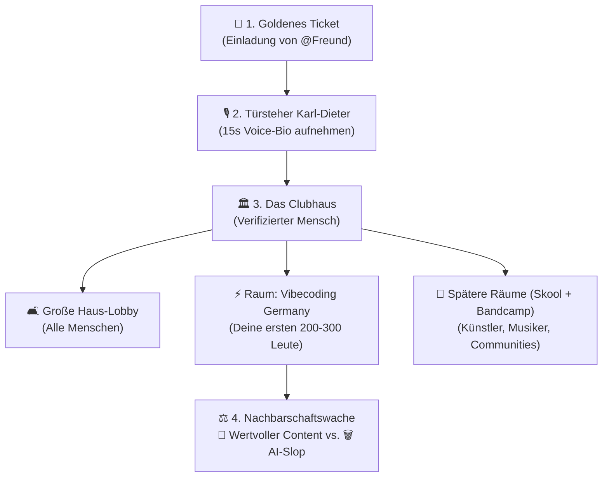

# 🏛️ HUMANS ONLY (2.0) – Der „2027-Ready“ Masterplan

> **Die Kern-Idee in einem Satz:**
> Ein warmes, exklusives Clubhaus für echte Menschen, in das man nur über Freunde reinkommt („Golden Tickets“), sich mit seiner echten Stimme vorstellt („Voice First“) und gemeinsam in kuratierten Themen-Räumen (Start: *Vibecoding Germany*) wertvollen Content statt seelenlosem AI-Slop teilt.

---

## 1. Das Konzept in 5 menschlichen Bildern (Analogien)

### 🏛️ Bild 1: Das Clubhaus mit Lobby & Wohnzimmern
* **Keine Geisterstadt mehr:** Statt eines riesigen, leeren Twitter-Marktplatzes betritt man ein gemütliches **Clubhaus**.
* **Die Haus-Lobby:** Ein gemeinsamer Haupt-Feed, in dem sich alle verifizierten Menschen begegnen können.
* **Die Wohnzimmer (Spaces / Räume):** Jeder Raum hat seinen eigenen **Raum-Chef** (Gastgeber).
  * **Phase 1 (Start):** Unser erstes Wohnzimmer ist **Vibecoding Germany** (200–300 Leute). Drinnen gibt es den **Raum-Feed** (Text, Bilder, Sprachnotizen), eine **Pinwand** (wichtige Links/Events oben angeheftet) und die **Mitglieder-Wand** (mit abspielbaren Voice-Intros).
  * **Phase 2 (Skool + Bandcamp Vibes):** Handverlesene Gastgeber (Künstler, Musiker, Community-Leader) bekommen eigene Räume – mit einer **Schaufenster-/Galerie-Ecke** für Videos, Musik oder Kurse und optionaler **Creator-Kasse** (kostenlos, Trinkgeld-Topf oder Mitgliedsbeitrag).

### 🎫 Bild 2: Das „Goldene Ticket“ & der Stammbaum (Clubhouse-Prinzip)
* **Kombi-Pass:** Wenn du jemanden in *Vibecoding Germany* einlädst, ist er damit automatisch für das ganze Haus verifiziert **und** sitzt direkt im Raum *Vibecoding Germany*.
* **3 Abreiß-Sticker:** Jedes neue Mitglied bekommt anfangs nur **3 Goldene Tickets** (im Design echte schräge Sticker zum Abreißen und Teilen).
* **Die Bürgschaft:** In jedem Profil steht stolz und anklickbar: **„Eingeladen von @Dennis“**. Dadurch entsteht ein sichtbarer **Vertrauens-Stammbaum**. Lädt jemand Spammer ein, fällt das auf den Bürgen zurück und er verliert seine Ticket-Rechte.

### 🎙️ Bild 3: Die „Vorstell-Runde“ (Voice-First Identität)
* Statt nerviger Roboter-Captchas (die wir komplett über Bord werfen!) ist der natürlichste Mensch-Beweis deine **echte Stimme**.
* **15-Sekunden Voice-Bio:** Beim Reinkommen drückt man kurz aufs Mikrofon und sagt in 15 Sekunden: *„Hey, ich bin …, ich baue gerade an …“*.
* Auf jedem Profilbild gibt es einen **Mango-Play-Button**: Ein Tipp darauf und man hört den echten Menschen hinter dem Profil. Auch im Feed lassen sich jederzeit kurze Sprach-Posts teilen.

### ⚖️ Bild 4: Die Nachbarschaftswache („Wertvoll vs. AI-Slop“)
* Wir sind **nicht** gegen KI als Werkzeug – wir sind gegen seelenlosen Copy-Paste-Müll.
* **Community-Prüfung statt Amtsgericht:** Unter jedem Beitrag gibt es ein kleines Prüf-Symbol. Wenn ein Beitrag als fragwürdig markiert wird, taucht unser Maskottchen **Karl-Dieter** auf und die Community stimmt mit einem Tipp ab:
  * **💎 „Wertvoller Content“** (darf bleiben & bekommt ein Qualitäts-Siegel)
  * **🗑️ „Weg damit (AI-Slop)“** (wird bei Mehrheit automatisch ausgeblendet)

### 🎨 Bild 5: Der Look – Papier, Tinte, Mango & Karl-Dieter
* Wir übernehmen zu 100 % das frische **Vibecoding Germany Brand-Design**:
  * **Farben:** Warmes Papier (`#faf7ef`) im Tag-Modus, warmes Studio-Schwarz (`#0a0a0a` / `#1c1b18`) im Nacht-Modus, knalliges **Vibe-Blau (`#0238ef`)** und **Mango-Gelb (`#fca50a`)**.
  * **Haptik:** Fette Tinte-Rahmen (`2px`–`3px`), schräge Sticker-Badges (`-2deg`), kräftige Überschriften (`Bebas Neue` / `Arial Narrow`) und der fertige Mango-Audio-Player.
  * **Karl-Dieter als Gastgeber:** Karl-Dieter steht als Türsteher auf dem Einladungs-Screen, überreicht die 3 Golden Tickets und moderiert die Slop-Abstimmung.

---

## 2. Das „2027-Ready“ Technik-Fundament (für dich & deine Partner)

Wir werfen den alten 2023er Twitter-Klon-Code weg und bauen ein sauberes, blitzschnelles System, an das **Web und Flutter** gleichzeitig andocken können:

### Warum diese Aufgabenteilung für dein Team perfekt ist:
1. **Ein einziges Gehirn (Supabase Datenbank + Regeln):** Alle Regeln (Wer darf wen einladen? Wer ist in welchem Raum? Wie wird abgestimmt?) stecken direkt in der Datenbank (Row Level Security & Datenbank-Funktionen).
2. **Stufe 1 – Die Sofort-Handy-App (PWA):** Wir bauen das Frontend in **Next.js 15 + Tailwind CSS** und kopieren uns die fertigen Design-Tokens (`vcg-tokens.css`), den Audio-Player und die Karl-Dieter-Grafiken direkt aus eurem `vibecoding-germany.de`-Projekt rüber. Als **PWA (Progressive Web App)** installiert man sie mit einem Klick auf dem Handy-Homescreen.
3. **Stufe 2 – Die Flutter/Dart-Partner:** Weil Supabase ein erstklassiges `supabase_flutter`-Paket hat, müssen wir für deine Mac-, iOS- und Android-Entwickler aus der Community **keine Zeile Server-Code doppelt schreiben**. Sie verbinden sich einfach mit denselben Tabellen und Audio-Speichern!

---

## 3. Die schlanke Datenbank (Nur 6 Kern-Bausteine statt 25)

Damit jeder Entwickler das System in 5 Minuten versteht, besteht unsere neue Datenbank zum Start nur aus **6 glasklaren Tabellen**:

| Baustein | Menschliche Bedeutung | Wichtigste Felder |
| :--- | :--- | :--- |
| **1. `profiles`** | Die Menschen im Clubhaus | `id`, `username`, `display_name`, `bio`, `avatar_url`, `voice_intro_url` (15s Audio), `voice_duration_sec`, `invited_by_id` (Der Stammbaum!), `invites_left` (Start: 3), `can_invite` (Boolean), `created_at` |
| **2. `invite_tickets`** | Die „Goldenen Tickets“ | `id`, `code` (unique), `creator_id`, `target_space_id` (z. B. Vibecoding), `redeemed_by_id`, `redeemed_at`, `expires_at` |
| **3. `spaces`** | Die Wohnzimmer / Räume | `id`, `slug` (`vibecoding-germany`), `name`, `description`, `owner_id` (Raum-Chef), `pinned_info` (JSON/Markdown), `access_type` (`invite`, `paid`), `price_cents` |
| **4. `space_members`** | Wer sitzt in welchem Raum? | `space_id`, `user_id`, `role` (`owner`, `moderator`, `member`), `joined_at` |
| **5. `posts`** | Beiträge (Text, Bild, Voice) | `id`, `author_id`, `space_id` (`null` = Große Lobby), `text`, `image_url`, `audio_url`, `audio_duration_sec`, `parent_id` (für Replies), `slop_status` (`clean`, `under_review`, `hidden`, `valuable_verified`), `valuable_votes_count`, `slop_votes_count`, `created_at` |
| **6. `content_votes`** | Die Nachbarschaftswache | `id`, `post_id`, `voter_id`, `vote` (`valuable` vs. `slop`), `created_at` (Unique: `post_id` + `voter_id`) |

*(Später für Phase 2 hängen wir `space_showcase_items` für die Bandcamp/Skool-Galerie dran).*

---

## 4. Unser Fahrplan: Konkrete Umsetzungsschritte

1. **Schritt 1: Alten Code ins Archiv schieben & Frischen 2027-Bau aufsetzen**
   * Alten Twitter-Klon in einen Unterordner `_legacy_v1` verschieben (nichts löschen, nur archivieren) und im Root/App-Verzeichnis ein brandneues, sauberes Next.js 15 Projekt mit dem **Vibecoding-Germany Design-System** und **Karl-Dieter** starten.
2. **Schritt 2: Den „Vibecoding Beta“-Durchstich bauen (MVP)**
   * **Screen 1:** Der **Türsteher-Screen** mit Karl-Dieter (Ticket-Code eingeben + 15-Sekunden-Voice-Intro einsprechen).
   * **Screen 2:** Das **Clubhaus** (Umschalter oben zwischen *„Große Lobby“* und *„⚡ Vibecoding Germany“*, Raum-Header mit Pinwand & Mitglieder-Wand, unten der fette Mango-Button für Text-, Bild- & Sprach-Posts).
   * **Screen 3:** Das **Profil mit Stammbaum** (*„Eingeladen von @…“*, Voice-Intro abspielen & die 3 Abreiß-Sticker für deine eigenen Golden Tickets).
   * **Feature 4:** Das **„💎 Wertvoll vs. 🗑️ Slop“-Voting** direkt an jedem Beitrag.
3. **Schritt 3: Einladungs-Dokument (`docs/FLUTTER_CONTRACT.md`) für die Flutter-Partner generieren**
   * Dokumentation des Supabase-Schemas, der RLS-Policies, Storage-Buckets und RPC-Funktionen für das Flutter/Dart-Team.
